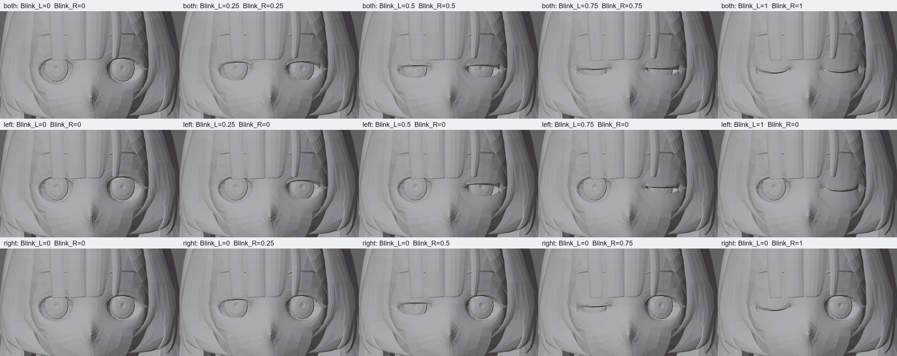

# Raphtalia — управляемое моргание

Дата: **21 октября 2026**. Актуальные файлы: [Raphtalia_prepared.blend](../../assets/models/Raphtalia_prepared.blend) и [Raphtalia_prepared.fbx](../../assets/models/Raphtalia_prepared.fbx). Результат — **429 деформирующих костей, 15 TEST Actions**, независимые `Blink_L` / `Blink_R`. Исходные 241 кость, 11 клипов, IK/FK, управление взглядом, ушами и бровями сохранены. Рот, артикуляция, эмоции и веса тела/одежды не дорабатывались.

Моргание проверено в Blender, после FBX/Assimp и при фактическом воспроизведении экспортированных костей отдельным OpenGL-аудитором JULIA. **Основной desktop по-прежнему не содержит animation player**: эти результаты не означают автоматического воспроизведения в его интерфейсе.

## Файлы, управление и просмотр

| Файл | Назначение |
|---|---|
| [BLEND](../../assets/models/Raphtalia_prepared.blend) | Авторский риг, независимые параметры, прежние и новые Actions |
| [FBX](../../assets/models/Raphtalia_prepared.fbx) | Геометрия, материалы, UV, веса и 15 запечённых skeletal clips; примерно 170 МБ |
| [Резервная копия до моргания](../../assets/models/backups/Raphtalia_prepared.pre_blink_2026-10-21.zip) | Точные прежние BLEND/FBX 241/11; старые резервные копии также сохранены |
| [Манифест](deliverable_manifest.json) | Размеры и SHA256 итоговых файлов и резервных копий |
| [Управление и команды](../../tools/raphtalia/README.md) / [runtime contract](runtime_audit.md) | Воспроизведение проверок и границы совместимости |
| [Изменения с provenance](blink/patch.json) | Карта каждой новой вершины/грани, веса и параметры построения |

Выберите объект `Raphtalia_Rig`, откройте Object Custom Properties: `Blink_L=0` / `Blink_R=0` открывает глаза, `1` закрывает соответствующий глаз. Стороны указаны относительно персонажа. Одинаковые значения управляют обоими глазами, разные — независимыми степенями закрытия. Перед ручной настройкой отключите активный TEST Action, иначе его ключи переустановят свойства. Новые служебные кости находятся в коллекции `Eyelids`; вручную позировать все эти кости не требуется.

[Состояния 0/25/50/75/100%](blink/states.png), [взгляд в шести направлениях](blink/gaze.png), [голова, взгляд и прежние брови](blink/head.png), [анимированный пример](blink/natural.gif). Камера и освещение в сравнениях одинаковы. Полные состояния каждого глаза сохранены отдельно рядом с контактными листами.

## Что фактически было в модели

[Аудит исходной топологии](blink/topology.json) выполнен по сохранённому снимку 241/11. `body_tex_skin_0` содержит два глазных проёма: после учёта совпадающих позиций каждый ограничен кольцом из **16 узлов**, то есть девятью точками верхнего и нижнего пути с общими уголками. Вокруг имеются три регулярных кольца кожи. Отдельных анатомических мешей верхнего и нижнего века нет.

`body_tex_skin2_0` образует склеры, `eye_tex_eyes_0` — видимые участки радужек, `hightlight_hightlight_0` — блики. Это стилизованные поверхности, а не полноценные замкнутые глазные яблоки. Взгляд управляется существующими `eye.L/R`; ресницы не должны следовать этим костям.

В `eyelashes_tex_eyelashes_0` на каждой стороне есть компоненты из 55 и 32 вершин, обе включают верхнюю и нижнюю части с уголками; отдельно существуют нижний акцент из восьми вершин, деталь верхней складки из 11 и бровь из 17. Простого разделения на два меша «верхние/нижние ресницы» нет. Кости `brow.L/R` и их исходные веса сохранены. Blink Shape Keys, blink drivers и костей век в исходном снимке не было; окологлазная кожа и ресничные участки в основном имели вес головы 1.

## Почему прежнее моргание было отклонено

Сохранённый `face_blink_probe.py` стягивал верхний и нижний края проёма к одной низкой линии и распространял трёхмерное смещение решением Laplacian внутри жёсткого пространственного радиуса. Решатель не ограничивал ориентацию треугольников, кривизну и поверхность глаз; вместе с веком двигалась кожа щеки. Положение по глубине задавалось эвристикой, а не проверялось относительно радужек и бликов.

Ресницы ниже общей отметки высоты получали смесь смещений трёх ближайших узлов всего проёма. Так смешивались верхний и нижний края, менялись ширина ribbon и положение отдельного нижнего акцента. Этот эксперимент не перенесён в итоговый риг.

Новые прототипы также не принимались по одному факту закрытия глаз. Аудит обнаружил перевороты крошечных треугольников у жёсткой границы весов, несовпадение горизонтальных узлов верхнего/нижнего пути и поздние складки внутри двух subdivided canthus-треугольников. Эти причины исправлены отдельно: топологическая поверхность вместо прямоугольной маски, общий XYZ-контур смыкания и локальное аффинное распределение весов в двух узких веерах.

## Выбранное решение и локальные изменения

Используется **костная деформация LBS без Shape Keys**. Качество обеспечивают локальная плотность сетки, форма общего контура, глубина относительно реальных глазных поверхностей и корректирующая сетка костей. Простое перемещение одной кости или только ресниц не использовано.

Добавлены **124 контурные кости**: по 31 подвижной точке для верхнего и нижнего пути каждого глаза; общие конечные уголки не требуют отдельных неподвижных костей. Ещё **64 кости** управляют двумя внутренними кольцами кожи. Все новые кости — дочерние существующей головы; исходные rest matrices и родители 241 кости не менялись. Итого 429 костей, максимум четыре влияния на вершину.

Закрытая линия имеет неглубокую расслабленную форму и согласованные касательные в уголках. Она общая для верхнего и нижнего пути по X, Y и Z. Поэтому нижнее веко участвует в закрытии, но его ресницы двигаются вместе с соответствующей кожей, а не независимо. Первоначальная пропорция 78/22 служила отправной точкой; итоговая высота линии и движения нижнего века адаптированы к топологии, это не фиксированное анатомическое соотношение.

Внутренние кольца кожи сходятся к общей линии относительно неподвижного внешнего кольца. Движение по глубине включает плавную дугу, а закрытая поверхность дополнительно проверена перед бликами при крайних направлениях взгляда. Drivers используют стандартные выражения `min/max/sin`, ограничивают вход 0..1 и не требуют внешних Python-функций. Это реальные смещения геометрии.

| Локальный mesh | Вершины до → после | Треугольники до → после |
|---|---:|---:|
| Кожа `body_tex_skin_0` | 14556 → 16299 | 27104 → 30494 |
| Ресницы `eyelashes_tex_eyelashes_0` | 246 → 2082 | 278 → 3488 |

Два прохода локального разбиения сохраняют исходные индексы и координаты вершин. Новые точки лежат на исходных треугольниках; UV и материалы переданы по barycentric provenance. Открытый силуэт, размеры глаз и расположение исходных ресниц не изменены. Для век локально исправлены sharp edges и нормали; глобальное сглаживание лица не выполнялось. Участки рта, волосы, одежда и прочие меши не перерабатывались.

Верхние/нижние ribbon, их уголки, брови и деталь складки классифицированы раздельно. Ribbon сохраняют исходные поперечные смещения; складка получает веса ближайшей поверхности кожи, брови сохраняют прежние веса. У совпадающих seam-вершин привязки согласованы. Прежние веса тела/одежды проверены на сохранность.

## Четыре диагностических клипа

Частота авторских Actions — 30 fps; все прежние 11 Actions сохранены без изменения ключей и handles.

| Action | Кадры | Содержание |
|---|---|---|
| `TEST_blink_natural` | 1..31 | Покой, закрытие 9→12, полное смыкание 12..14, более медленное открытие 14→20 |
| `TEST_blink_independent` | 1..61 | Левый глаз, затем правый, с возвратом в нейтраль |
| `TEST_blink_gaze` | 1..121 | Прямо, вверх/вниз ±8°, по горизонтали ±12°, диагональ 10°/6°; моргание на удерживаемом взгляде |
| `TEST_blink_head` | 1..121 | Повороты и наклоны головы, взгляд, прежние брови и три моргания |

## Проверки качества и сохранности

[Integrity](blink/integrity.json) подтверждает сохранение исходных костей, Actions, прежних drivers/constraints, IK/FK, материалов и текстур. Исключения геометрии ограничены документированным разбиением и нормалями окологлазной кожи/ресниц. Исходные координаты вершин сохранены точно. Новые точки и нейтральная вычисленная поверхность имеют погрешность хранения/LBS до примерно **0,154 мкм** в мировом пространстве; bit-exact вычисленной поверхности честно не заявляется. Максимальная ошибка суммы весов — `4.58e-8`, максимум влияний — четыре.

[Проверка видимости](blink/visibility.json): 126 состояний — шесть направлений взгляда, пять общих уровней закрытия и два wink, три камеры 0/−25/+25°. Проверялись evaluated вершины, середины рёбер и центры треугольников радужек, склер и бликов. Только кожа считается перекрывающей поверхностью: волосы и ресницы не могут скрыть ошибку этого теста. **216 проверок закрытых глаз прошли без утечек; 108 проверок противоположного глаза при wink прошли без изменений видимого набора.** Минимальный измеренный запас перекрытия бликов — около 0,822 мм.

[Аудит уголков](blink/corner_audit.json) дополнительно исследует 33 состояния с шагом 10%, оба глаза и независимые wink. Вырожденных треугольников нет; минимальная площадь около 38,8% исходной. На 0..90% новых соседних складок >120° нет. При полном контакте остаются локальные canthus hinges; [проверка их видимости](blink/hinge_visibility.json) показала, что тонкая сторона 12 таких пар занимает менее 0,08 px² и скрыта кожей/ресницами в контрольной камере. Это отличается от отклонённых видимых складок почти на 180°. Смена знака почти нулевой проекции не выдаётся за самостоятельное доказательство физического разворота.

Визуально проверены все уровни каждого глаза, шесть направлений взгляда, боковой вид и комбинированная анимация. Широкие складки щеки и самостоятельный дрейф нижнего акцента прежнего эксперимента устранены. **Небольшое стягивание в уголках при 100% остаётся ограничением исходной стилизованной топологии**, заметным на очень крупном плане. Контакт/небольшое перекрытие верхней и нижней поверхностей вдоль линии смыкания намеренные; отсутствие вообще всех пересечений не заявляется. Конечная выборка не доказывает качество для любых произвольных экстремальных поз и камер.

## Экспорт, Assimp и настоящий OpenGL

FBX содержит запечённые TRS костей, а не зависимости от Blender drivers. Shape Keys/morph targets отсутствуют и для итогового решения не нужны. Дополнительный [morph-аудит](blink/morph.json) проверяет именно массивы/каналы морфов и подтверждает нулевые количества; успешный импорт обычной геометрии не используется как доказательство morph-поддержки.

Базовый bake с шагом 1 кадр давал до 1,006 мм расхождения между кадрами. Поэтому итог экспортирован с шагом **0,25 кадра, 120 samples/sec**, simplify 0. [Roundtrip](blink/roundtrip.json) сравнивает 216 поз, включая фактические 25/50/75% кривых и дробные кадры: 429/429 костей, 15/15 Actions, родители и веса сохранены; максимальная ошибка нейтрали **0,00196 мм**, анимации **0,03192 мм**. Топология, UV и материалы Blender→FBX сохранены. Небольшая разница corner normals после импорта измерена: максимум около 0,797°.

Поле `source_neutral_max_delta_m` старого roundtrip-инструмента сравнивает **ближайшие вершины**, а не поверхности. После добавления midpoint оно даёт 20,77 мм расстояния от новых точек до старых вершин; это не перемещение исходной кожи. Сохранность поверхности доказывает provenance/area/UV в integrity, а не эта неподходящая к разбиению vertex-метрика.

| Assimp 6.0.4 | Source validation | Project postprocess |
|---|---:|---:|
| Узлы / meshes / материалы | 459 / 28 / 26 | 459 / 28 / 26 |
| Вершины / треугольники | 206832 / 68944 | 171523 / 68942 |
| Palette entries / клипы | 429 / 15 | 429 / 15 |
| Максимум влияний | 4 | 4 |
| Invalid / unweighted / nonunit / unresolved / nonfinite | 0 | 0 |

[Assimp evidence](blink/assimp.json) использует те же project flags; два прежних вырожденных исходных треугольника удаляет существующий pipeline. Никакого нового GPU-лимита 256 костей в JULIA нет: texture-buffer palette проверяется через `GL_MAX_TEXTURE_BUFFER_SIZE`. 429 матриц занимают **27456 байт**.

[OpenGL-протокол](blink/gpu/gpu_audit.txt): настоящий `GLModelLoader` + `OpenGLRenderer`, независимый Assimp TRS/quaternion sampler, 307 изображений, **все 15 клипов изменяют rendering, GL errors = 0, bind reset = EXACT**, начало и конец каждого клипа совпадают. Для моргания выбраны реальные закрытые ключи и дробные уровни, а не только четверти длительности, которые могли бы пропустить короткий blink. Сохранены [35 состояний / 70 крупных планов](blink/gpu/manifest.json), [уровни и wink](blink/gpu/blink_levels_contact.png), [взгляд](blink/gpu/blink_gaze_contact.png), [голова](blink/gpu/blink_head_contact.png).

[Нейтраль до/после](blink/gpu/neutral_before_after.png) использует одинаковые настройки: средняя абсолютная разница RGB в крупном плане глаз — 0,00673 на шкале 0..255; небольшое изменение связано с локальным разбиением/нормалями. В исходном prepared FBX уже не было Assimp texture slots; текущие Workbench/GPU кадры показывают clay-материалы. Материалы, UV и файлы текстур не удалялись. Это проверка геометрии и существующего shader path, **не подтверждение текстурированного beauty render**.

| Уровень готовности | Результат |
|---|---|
| Blender: управление и геометрия | Проверено, независимые параметры и четыре клипа работают |
| FBX → Assimp: данные | Проверено, 15 запечённых skeletal clips и все 429 костей |
| OpenGL: воспроизведение | Проверено отдельным аудитором на существующем renderer API |
| Desktop JULIA: пользовательский playback | Пока отсутствует; importer не сохраняет clips после уничтожения Assimp scene |

Evidence создано на отдельных кандидатах с теми же байтами, которые затем записаны в `Raphtalia_prepared.*`; SHA256 сопоставлены с итоговым манифестом. Оригинальный `Raphtalia.fbx` и его backup сохраняют SHA256 `A602086AC9E580F2D265A489478922B75AAE00410313B17A89BD846AD4F3B34C`.

## Следующий этап

Для JULIA требуется сохранять skeletal clips/channels и реализовать обычный TRS playback; новый morph shader для этого моргания не нужен. Параметры Blender сами по себе не являются runtime API: для живого `Blink_L/R` следует перенести стандартные выражения движения костей или использовать запечённые клипы с лицевыми masks. C++-рендерер на этом этапе не переписывался.

Речевую мимику следует начинать отдельным аудитом губ, внутренней поверхности рта, зубов/языка и челюсти, сохраняя нынешние глазные области и контроллеры. Их наличие/готовность не выводится из успешного blink. Затем отдельно выбирать костные и/или морфологические коррекции с практическим FBX/Assimp roundtrip. Новые эмоциональные выражения на этом этапе не создавались.

---

<!-- BODY_STAGE_ARCHIVE -->
## Предыдущий этап: тело и одежда, снимок 241/11

Ниже сохранён отчёт предшествующего этапа. Его формулировки «текущий файл», количества 241/11 и ссылки `deep_deformation/` относятся к **снимку до моргания**, сохранённому в pre-blink архиве. Они не заменяют приведённые выше проверки 429/15. Старые исправления тела/одежды сохранены.

Дата: **21 октября 2026**. Текущий результат: **241 деформирующая кость, 11 TEST-клипов**, прежние Blender-контроллеры и локально улучшенные веса тела и костюма. Исходная точка этого этапа — фактическая подготовленная модель с 241 костью и 10 Actions из сохранённого архива. Состояние проверено заново в Blender, через экспорт FBX, Assimp и настоящий OpenGL-путь JULIA.

Работа ограничена телом и одеждой. Лицо, его кости, веса, Actions, ограничения и drivers сохранены; моргание, речь и эмоции не разрабатывались. Новых костей, Shape Keys, симуляции ткани или изменений C++-рендерера нет. Глубокие складки и пересечения юбки полностью устранёнными не объявляются.

## Файлы и возможность отката

| Файл | Состояние |
|---|---|
| [Raphtalia_prepared.blend](../../assets/models/Raphtalia_prepared.blend) | Текущая редактируемая модель и существующие средства управления |
| [Raphtalia_prepared.fbx](../../assets/models/Raphtalia_prepared.fbx) | Те же исправленные статические веса и 11 запечённых клипов |
| [Архив перед этим этапом](../../assets/models/backups/Raphtalia_prepared.pre_deep_deformation_2026-10-21.zip) | Точные BLEND/FBX состояния 241/10 и manifest |
| [Оригинал](../../assets/models/Raphtalia.fbx) / [его backup](../../assets/models/backups/Raphtalia.original.fbx) | Оба SHA256 `A602086AC9E580F2D265A489478922B75AAE00410313B17A89BD846AD4F3B34C`; не изменены |
| [Манифест](deliverable_manifest.json) | Размеры и SHA256 текущих файлов и обоих prepared-архивов |
| [Команды и управление](../../tools/raphtalia/README.md), [runtime contract](runtime_audit.md) | Воспроизведение, экспорт и ограничения JULIA |

Нейтральные позиции вершин, топология, UV, материалы, corner normals, все 241 rest matrices/родители и прежние 10 Actions совпадают с началом этапа точно. Сохранены свойства и формы контроллеров, IK/FK, ограничения и drivers. [integrity.json](deep_deformation/integrity.json) содержит хэши, все проверки и каждую изменённую вершину. Защита лица охватывает все head/hair meshes и верхнюю часть body; neck-вес заклёпки брони не превращает эту деталь одежды в лицевую геометрию. Любые изменения весов за пределами явного списка тела/костюма запрещены проверкой.

## Воспроизведённые проблемы и приоритеты

| Приоритет | Реальный дефект и условия | Причина |
|---|---|---|
| 1 | Пояс, кольца и верх юбочных панелей ломаются при yaw корпуса 30°, наклоне 45° и комбинированной позе | Низ одежды привязан к lumbar spine, тогда как цепочки ткани начинаются от таза; отдельные части креплений имеют разные веса |
| 1 | Короткие складки чулка у колена вытягиваются при 90–135°, локальные швы обуви растягиваются при сгибании стопы | Неравномерный переход thigh/shin и противоположные назначения соседних вершин сложенного шва |
| 2 | Нагрудник и его отделка деформируются как мягкая ткань, плечевые заклёпки расходятся при поднятии руки | Части одной жёсткой детали имеют разные влияния; одна заклёпка полностью следует шее |
| 2 | Узел и ленты банта растягиваются при одностороннем движении ключицы | Отдельные островки одного аксессуара имеют разные clavicle-веса |
| 2 | Переходы подмышки, рукава и таза дают локальные заломы при подъёме рук, twist и глубоком сгибании бедра | Неравномерный переход влияний по UV-разрывам; малый spine residual чередуется между соседними сегментами |
| 3 | Сильное уплощение глубокого сгиба и проникновение коленей через перед юбки | Ограничения исходной низкополигональной формы и LBS; свободная ткань не имеет автоматических коллизий |

Дефекты воспроизведены по реальным вершинам и позам, а не перенесены из прежнего отчёта: [before.json](deep_deformation/before.json), [сравнение](deep_deformation/comparison.png). Углы — добавки к асимметричной запечённой rest pose, а не медицинский диапазон движения. Исправные суставы и иерархия не перестраивались.

## Выполненные локальные исправления

Изменены **5308 уникальных вершин в 9 meshes**:

| Mesh | Изменено вершин |
|---|---:|
| `armor_tex_armor_0` | 819 |
| `belt_tex_belt_0` | 452 |
| `body_tex_skin_0` | 760 |
| `bow_tex_bow_0` | 584 |
| `shirt.001_tex_shirt_0` | 168 |
| `shirt_tex_shirt_0` | 1040 |
| `shoes_tex_shoes_0` | 144 |
| `shoulder_armor_tex_shoulderarmor_0` | 1032 |
| `stocking_tex_sock_0` | 309 |

- **Тело:** переходы рука/торс в подмышках, бедро/таз и малые остаточные spine influences верхней груди. Фильтруется скалярная доля двух физических семейств по графу рёбер и совпадающим seam-вершинам. Существующие кости влияния и отношения основной/twist внутри семейства сохраняются. Лицо и шея исключены отдельно; локти, кисти и стопы тела не подвергались общему сглаживанию.
- **Рукава:** отдельно согласованы shoulder-girdle/chest и arm/girdle переходы; жёсткие и отсутствующие семейства влияний не создаются заново. Манжеты и перчатки сохранены. Дополнительная [проверка рукавов](deep_deformation/sleeve_validation.json): 120 позовых samples, включая прежние клипы и знаковые стресс-повороты; роста max ratio/over_2 в этой выборке нет.
- **Чулки:** ограниченная offline-подгонка только доли shin/thigh по нескольким движениям, с сохранением списка влияний и primary/helper split. Бюджет оптимизатора — 100 вычислений; остановка по бюджету не трактуется как доказательство сходимости. Полученные статические веса проверены на дополнительных движениях, которые не входили в подбор.
- **Обувь:** согласованы лишь короткие связные складки у голеностопа. Подошва, носок и голенище не превращены в один жёсткий блок. [limb_validation.json](deep_deformation/limb_validation.json) содержит 179 samples на вариант, независимые углы, поперечные/продольные повороты и прежние Actions.
- **Пояс и свободные панели:** attachment нижней части согласован с `root.x_01`, выше сохранён плавный переход к lumbar spine. Замкнутый пояс, его пряжка и целые островки металлических колец следуют единому attachment. Существующие 54 кости ткани и их родители не менялись.
- **Броня:** shell/толщина/отделка нагрудника согласованы с chest; высокие clavicle straps оставлены. Плечевая пластина и заклёпки следуют одной существующей arm-twist кости. Это локальное исправление жёсткой детали, а не глобальная rigid-привязка одежды.

- **Бант у воротника:** лента, узел, петли, короткие концы и отдельные островки толщины согласованы с существующей `spine_03.x_016`. Разные clavicle-веса раньше растягивали малые рёбра узла при одностороннем движении плеча. Геометрия аксессуара и шея не менялись. [Изолированная проверка](deep_deformation/bow_validation.json): 75 пар поз; окончательная модель дополнительно проверена общим integrity/roundtrip/GPU.

Все итоговые веса нормализованы, не более четырёх влияний на вершину. Полный журнал before/after: [weight_patch.json](deep_deformation/weight_patch.json). Исходные twist drivers и управление остаются рабочими. Blender-зависимых corrective drivers/morphs в результате нет: исправления работают в том же LBS, который использует JULIA.

**Отклонённые варианты:** общий knee smoothing ухудшал отдельные сгибы; широкая диффузия обуви давала паразитную мягкость и ухудшала промежуточные движения. Автоматический подъём юбочных цепочек от бедра менял силуэт и растягивал швы панелей: [три отклонённых варианта](deep_deformation/rejected_lift.json). Эти изменения не включены. Численное улучшение не использовалось для оправдания заметного визуального ухудшения.

## Визуальные сравнения и численные результаты

[Семь пар «до → после»](deep_deformation/comparison.png) используют одинаковые позы, камеры, видимые объекты, масштаб и освещение: талия при повороте/наклоне, плечи в двух движениях, колени, голеностоп и таз. [comparison.json](deep_deformation/comparison.json) проверяет определения поз/камер, хэши изображений и содержит per-pose/per-mesh дельты.

Видимое улучшение наиболее выражено у пояса, круглых креплений, верхних панелей и края нагрудника. Рукава и переходы ног улучшены локально; внешняя разница отдельных кадров невелика. В OpenGL также проверены все шесть пиков нового клипа с близкими видами плеча, талии, колена и обуви. Отсутствие новых разрывов не означает отсутствия всех пересечений. Дополнительно сохранены пары банта при [движении ключицы до](deep_deformation/before_bow_clavicle.png) / [после](deep_deformation/after_bow_clavicle.png), [движении шеи до](deep_deformation/before_bow_neck.png) / [после](deep_deformation/after_bow_neck.png) и [верхней груди до](deep_deformation/before_bow_upper_chest.png) / [после](deep_deformation/after_bow_upper_chest.png). Последняя пара также показывает сохранённое пересечение концов банта с бронёй.

Таблица: максимальное отношение длины ребра к rest / число рёбер >2×. Исключены почти нулевые rest-рёбра. Эти показатели локализуют растяжение, но не измеряют естественность, потерю объёма и коллизии.

| Поза | До | После |
|---|---:|---:|
| Поворот корпуса 30° | 5.111 / 28 | 1.184 / 0 |
| Наклон корпуса 45° | 4.671 / 62 | 1.263 / 0 |
| Руки вверх + поворот | 5.111 / 69 | 2.629 / 7 |
| Руки вперёд 100° | 4.339 / 49 | 2.543 / 6 |
| Колени 120° | 2.771 / 7 | 1.700 / 0 |
| Стопы −30° | 4.030 / 2 | 1.684 / 0 |
| Бёдра 90° | 2.369 / 4 | 2.012 / 1 |
| Глубокое приседание | 4.030 / 30 | 2.012 / 1 |
| Движение цепочек ткани | 3.549 / 24 | 1.663 / 0 |

В 8 парах pose/mesh присутствуют увеличившиеся диагностические показатели (p99); наибольшая прибавка p99 — 0.03087. Все дельты сохранены, а не скрыты усреднением. Оценка принятых компромиссов опирается также на локальные кадры и независимые проверки промежуточных движений. Модель не заявляется идеальной в каждом крайнем положении.

## Практические испытания и экспорт

| Проверка | Фактический результат |
|---|---|
| Новый body/clothing audit | 50 отдельных и комбинированных поз; NaN/Inf = 0 |
| Прежний широкий аудит | 53 поз до / 54 после; дополнительная запись — новый TEST Action; NaN/Inf = 0 |
| Каждая локальная ось всех костей, +5° | 723 вращения; NaN/Inf = 0. Поз с рёбрами >2×: 12 → 0; max ratio 3.127 → 1.816. Это малые углы; метрики не измеряют объём и не заменяют глубокие позы: [до](deep_deformation/joint_sweep_before.json) / [после](joint_sweep.json) |
| Контроллеры и структура | [controls.json](deep_deformation/controls.json) / [structure.json](deep_deformation/structure.json): PASS; проверка сохранности — PASS |
| Blender → FBX → Blender | 87 sampled poses, 11/11 Actions, 241/241 костей, родители и веса сохранены |
| Assimp 6.0.4 | Source validation и точные project postprocess flags; по девять CPU samples каждого клипа в каждом режиме, нечисловых значений нет |
| Реальный OpenGL | 166 сохранённых изображений, все 11 клипов меняют rendering, GL errors = 0, bind reset = EXACT |

Roundtrip: максимальная ошибка нейтрали 0.00223 мм, анимационной поверхности 0.01451 мм. Порог 0.01 мм превышен в 15 samples; все ниже 0.02 мм. UV/топология/материалы сохранены; небольшая разница corner normals после FBX измерена и не выдаётся за побайтовое совпадение shading. Полные данные: [roundtrip.json](roundtrip.json).

Текущий FBX через Assimp:

| Показатель | Source validation | Project postprocess |
|---|---:|---:|
| Узлы | 271 | 271 |
| Meshes | 28 | 28 |
| Вершины | 187032 | 167327 |
| Треугольники | 62344 | 62342 |
| Материалы | 26 | 26 |
| Клипы | 11 | 11 |
| Максимум влияний | 4 | 4 |

В обоих режимах invalid/unweighted/nonunit vertices, unresolved bones/channels и нечисловые ключи/матрицы/поверхности — ноль. 241 palette entry включает пустые clusters; положительные vertex assignments имеют 228 имён костей. Два вырожденных треугольника удаляет прежний project pipeline. Текстуры/UV/материалы не удалялись и не переназначались. [assimp_after.json](deep_deformation/assimp_after.json).

GPU использует существующие `GLModelLoader` и `OpenGLRenderer`, скрытый GL 3.3 context и независимый TRS/quaternion sampler. Проверены настоящие экспортированные движения, не только успешная загрузка. Начало и конец каждого клипа совпадают побайтово на всех десяти ракурсах. Animation-neutral отличается от imported bind на малую величину: max palette delta 2.12193e-05, максимум 739 RGB bytes; поэтому равенство animation-neutral и bind не заявляется. Отдельная повторная отрисовка bind точна. Сохраняются прежние masked-composition и пять TRS crossfade-проверок.

GPU evidence: [протокол](deep_deformation/gpu_after/gpu_audit.txt), [samples](deep_deformation/gpu_after/gpu_samples.csv), [endpoints](deep_deformation/gpu_after/gpu_endpoints.csv), [body/clothing closeups](deep_deformation/gpu_after/gpu_body_cloth_contact.png), [baseline](deep_deformation/gpu_before/gpu_body_cloth_contact.png). SHA256 в Blender/Assimp/GPU evidence и манифесте привязаны к текущим файлам; генератор отчёта отклоняет устаревшие результаты.

## Оставшиеся ограничения и следующий этап

1. Глубокие сгибы коленей/локтей сохраняют характерное для LBS уплощение и исходную гранёность. Общий DQS/Preserve Volume только в Blender нарушил бы соответствие JULIA, поэтому не включён.
2. При глубоком приседании и высоком шаге колени/бёдра могут проходить через юбку. Существующие цепочки позволяют ручное позирование панелей; автоматических коллизий и физики ткани нет. Умеренные движения устойчивее, но универсальная collision-free сертификация не заявляется.
3. При крайнем подъёме вперёд плечевая пластина может располагаться почти ребром и тесно прилегать к рукаву; под грудью в сильном наклоне остаётся жёсткое сжатие. При отдельном локальном наклоне верхней груди +20° концы банта пересекают нагрудник так же, как до исправления крепления; эта коллизия не устранена. Эти места требуют авторинга конкретных движений и дальнейшей локальной проверки.
4. Исходная асимметричная rest pose, масштаб и ориентации локальных осей не изменены. Внешние движения требуют согласования retargeting, контактов и root motion. Автоматического FK/IK matching и полного foot-roll нет; прежнее управление сохранено.
5. Основное приложение по-прежнему статическое: standalone sampler не добавляет animation player, state machine или morph playback. Новые веса уже совместимы с runtime skinning; воспроизведение клипов — отдельная интеграционная задача.
6. Крайние сгибания запястья +45/+60° и пальцев сохраняют прежние ограничения сжатия/пересечения. Эти зоны проверены, но их веса на этом этапе не менялись; успешный finite/GPU-тест не означает естественной формы в крайних позах.

Для следующего этапа: авторить движения с ручными ключами существующих юбочных цепочек и проверить контакты; затем отдельно рассматривать совместимые pose-correctives, только с реальной поддержкой в JULIA и новым roundtrip/GPU сравнением. Лицевая анимация остаётся отдельной будущей задачей.

Исходный `Raphtalia.fbx`, текстуры, другие модели и ранние backups сохранены. Промежуточные пробы находятся в build и не заменяют final evidence; очистка затрагивает только явно созданные на этом этапе временные файлы: [журнал](deep_deformation/cleanup.json). `reaudit/` и `history/2026-10-20/` относятся к предыдущим этапам, а не к текущим количествам костей/клипов.
