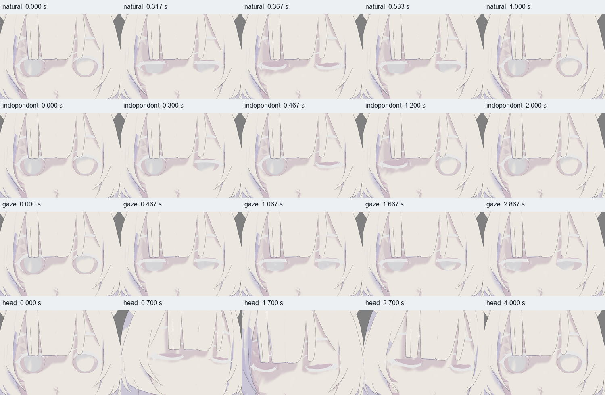

# Raphtalia: интеграция в desktop JULIA — технический отчёт

Проверка: **21 октября 2026**, Windows/MSVC Release, Assimp 6.0.4, OpenGL 3.3 NVIDIA 617.42, RTX 4070 SUPER. Основной `julia_desktop.exe` загружает подготовленную Raphtalia и воспроизводит все 15 клипов, включая четыре клипа моргания. **Оригинальная текстурированная внешность пока не восстановлена: в доступных исходниках нет нужных изображений и назначений. Полная задача поэтому не объявляется завершённой.**

## 1. Состояние проекта до изменений

- `GLModelLoader` уже импортировал геометрию, материалы, UV, до четырёх весов, иерархию и inverse bind; необходимые Assimp/GLM/GLFW/GLAD/stb были установлены.
- `GLModel::skinningMatrices` и `OpenGLRenderer::renderModel` уже обеспечивали scene-space LBS и texture-buffer палитру без ограничения 128/256 костей. Шейдер обслуживает основной, теневой и контурный проходы.
- Desktop загружал `Raphtalia.fbx`, рисовал статическую геометрию и предоставлял орбитальную камеру. `aiAnimation` уничтожались вместе с importer. `libs/render/src/RenderSystem.cpp` — только заготовка `force_link_render_system`, не animation runtime.
- `tools/raphtalia/gpu_pose_audit.cpp` воспроизводил клипы независимым Assimp-семплером через настоящие loader/renderer. Его интерполяционный и матричный контракт использован в production playback; аудитор оставлен независимым эталоном.
- Историческая документация уже отмечала отсутствие texture slots в исходном/prepared FBX и несовместимость трёх атласов `Raphtalia1.fbx` с целевыми UV. Это подтверждено повторно.

## 2. Очистка проекта

До удаления проверены назначение файлов, ссылки в исходниках, CMake, тестах и инструментах. Пофайловый список с размерами, SHA256 и основаниями: [desktop/cleanup.json](desktop/cleanup.json).

Удалены **42 файла**:

- 36 воспроизводимых `tools/raphtalia/__pycache__/*.pyc`, включая кэш уже отсутствовавшего `deep_cloth_controls.py`. Это не входы сборки/тестов; исходные Python-инструменты сохранены. Каталог уже исключён через `tools/raphtalia/.gitignore`.
- Шесть пустых `.gitkeep`: в `assets/models`, `assets/shaders`, `assets/textures`, `tools`, `tests`, `docs`. Каталоги содержат отслеживаемые файлы. В действительно пустых каталогах placeholders оставлены.

Сохранены исходный `Raphtalia.fbx`, prepared FBX/BLEND, все backups, другие модели, PNG, shaders, Python/bpy, vcpkg, экспортные и диагностические инструменты, Assimp/morph/GPU-аудиторы и историческое evidence. Проверены SHA256 всех семи записей [deliverable_manifest.json](deliverable_manifest.json): без изменений.

`Raphtalia1.fbx`, `Albedo.fbx`, `docs/raphtalia.rar`, старые build/audit-каталоги и исторические генераторы не удалялись: отсутствие их в executable не доказывает ненужность для разработки. RAR содержит архив прежних отчётов и диагностических изображений, исходного комплекта texture maps в нём не найдено. Копия assets рядом с EXE нужна для переносимого запуска.

Исторический `write_report.py` по-прежнему нельзя запускать поверх текущего отчёта: он предназначен для этапа 241/11. Генераторы ранних стадий сохранены с предупреждениями и архивами.

После очистки старый desktop успешно прошёл `--verify`; исходная CMake-конфигурация прошла с установленными пакетами. Полная пересборка завершена вместе с интеграцией, затем пройдены 13/13 тестов. Sandbox ограничивал запуск дочерних процессов Ninja; сборка выполнена через разрешённый запуск вне этого ограничения. Автообновление vcpkg обращалось к недоступному `D:/libraries/vcpkg_downloads`; добавлен явный `tools/build.ps1 -UseInstalledDependencies`, использующий имеющиеся пакеты. Вторая система сборки не создавалась.

## 3. Архитектура загрузки и воспроизведения

`GLModel` владеет meshes, nodes, bones и `AnimationClip`. Клипы, каналы и ключи не хранят указателей в `aiScene`. Сразу после `GLModelLoader::loadFromFile` importer уже уничтожен, а анимации полностью доступны.

`GLModelLoader::copyAnimations` сохраняет имя, duration в ticks, ticks-per-second и все position/rotation/scale keys. Каналы один раз разрешаются в индексы **всех nodes**, включая helpers. Неизвестные/неоднозначные nodes, повторные channels, неупорядоченные/NaN ключи и нулевые quaternions отклоняются с диагностикой.

Для Assimp `mTicksPerSecond == 0` принят явный fallback **25 ticks/s**, отмеченный `usedDefaultTicksPerSecond`. Это соглашение JULIA для неоднозначных файлов, не определение авторской частоты. У Raphtalia значение явно **30 ticks/s**, экспортные ключи идут через **0,25 tick**, то есть 120 samples/s. Ни одно из этих значений не является FPS экрана. Длительность — `durationTicks / ticksPerSecond`.

Новые `plugins/render_opengl/Animation.hpp` / `src/Animation.cpp` содержат структуры ключей, `sampleAnimation` и `AnimationPlayer`. Они не требуют имён костей Raphtalia. Bind TRS декомпозируется один раз при добавлении node тем же Assimp-методом, который применял аудитор.

Семплирование и матрицы:

1. Неанимированные узлы сохраняют точные imported local matrices.
2. Translation/scale интерполируются линейно, quaternion — нормализованным SLERP по короткой дуге. Соседние ключи ищутся через `upper_bound`.
3. Отсутствующий компонент берётся из bind TRS. Одиночный ключ и время вне ключевого диапазона используют ближайшее значение; полностью пустой канал сохраняет bind matrix. FBX pre/post extrapolation и morph/mesh channels не реализованы.
4. Локальная матрица — `T × R × S`; globals считаются parent→child через прежний `GLModel`.
5. Палитра — `globalNode × adjustedOffset`, где `adjustedOffset = aiBone.offset × inverse(meshGlobalBind)`. Imported root уже учтён в запечённых вершинах; второй `inverse(root)` не применяется.

У `GLModel::skinningMatrices` добавлен вариант со scratch/output spans; старый API, возвращающий vector, сохранён и использует ту же реализацию. Player заранее выделяет local/global/palette buffers. Обычный update не создаёт новых vector/map, строки каналов не ищутся заново. Пауза и остановка не пересчитывают позу каждый кадр.

Player хранит clip, время в секундах, `Stopped/Playing/Paused/Finished` и loop. `update(deltaSeconds)` использует прошедшее время `glfwGetTime`. Loop учитывает несколько циклов за update, nonloop удерживает последний кадр. `stop()` возвращает **точный imported bind**, сохраняя выбор клипа; `seek()` зажимает время в диапазон. Модель должна переживать player и оставаться неизменной во время его использования.

RenderSystem не переписывался: существующий desktop loop обновляет player и передаёт palette в прежний renderer. Разовая `fitToHeightTransform(2.2)` не зависит от анимированной позы и не меняет пропорции.

## 4. Raphtalia, GPU, материалы и текстуры

Основной ассет — `assets/models/Raphtalia_prepared.fbx`. Desktop ищет assets относительно EXE, затем использует compile-time source fallback. Другую модель можно передать первым аргументом. У текущей Raphtalia: **459 nodes, 28 meshes, 26 исходных материалов, 429 palette entries, 15 clips**, по 430 skeletal channels на clip. Исходный и prepared файлы не переэкспортировались.

Все 429 matrices передаются прежним `GL_RGBA32F` texture buffer: четыре texel на `mat4`, **27456 байт**. На проверенном GPU `GL_MAX_TEXTURE_BUFFER_SIZE = 268435456` texels, допустимо 67108864 matrices. Проверяется реальный device limit и размер palette. Шейдер проверяет диапазон IDs, использует до четырёх нормализованных влияний; skinning общий для основного/теневого/контурного проходов. Новых лимитов костей нет. Upload использует прежний streaming `glBufferData`; добавлен замер CPU-времени отправки для аудита.

**Оригинальные текстуры не восстановлены.** [Повторный read-only аудит](desktop/materials.json) установил:

- Исходный и prepared FBX имеют 26 материалов, но **0 Texture / 0 Video objects**; Assimp получает 0 texture slots.
- В prepared BLEND **0 images**, ни одного image texture node; Principled материалы содержат diffuse около 0,8 и Normal Map без изображения. Экспорт не может восстановить отсутствующие изображения/связи.
- В `assets/textures` лишь `body_color.png`, `hair_color.png`, `shield_color.png`, относящиеся к соседней `Raphtalia1.fbx`. Их несовместимость с целевыми UV зафиксирована предыдущим аудитом. Назначать их по подстрокам `skin/hair` было бы ошибкой.
- Desktop сообщает `Textured meshes: 0/28`, mask/blend meshes — 0. Визуально видна однотонная светлая модель. Оригинальная прозрачность волос/ресниц по этим данным не устанавливается.

Renderer поддерживает назначенные/embedded diffuse/base-color images, UV channel/transform, sRGB decode, Mask/Blend alpha и samplers; регрессии этих механизмов проходят. Глобальный эвристический fallback не включался; художественные цвета, UV и геометрия не подменялись. Для окончания нужны карты именно этой модели и достоверные assignments, затем подключение и визуальная проверка в desktop. PBR/normal-map pipeline отсутствует.

## 5. Управление в desktop

Запуск: `julia_desktop/julia_desktop.exe`. Автоматически воспроизводится `TEST_blink_natural` с повторением, список клипов печатается в console. Заголовок четыре раза в секунду показывает clip, состояние, время/длительность, loop и FPS приложения.

| Действие | Клавиши |
|---|---|
| Список клипов в console | F1 |
| Предыдущий / следующий клип с запуском | PgUp / PgDn |
| Запуск / пауза / продолжение | Space |
| Остановка и точная bind-поза | X или R |
| Повторение | L |
| Шаг назад / вперёд с паузой на 1/30 с | `,` / `.` |
| Natural / independent / gaze / head blink | 1 / 2 / 3 / 4 |
| Камера на лицо / общий вид | F / B |
| Орбита / зум / панорамирование | ЛКМ / колесо / ПКМ, СКМ или Shift+ЛКМ |
| Перемещение камеры / выход | WASD/QE, стрелки / Esc |

1–4 выбирают **запечённые клипы**, а не программные `Blink_L/R`. Blender drivers не становятся готовым C++ API.

## 6. Результаты тестирования

**Release собран, новых compiler warnings нет, CTest 13/13 Passed, 10,91 с**: core, events, orbit_camera, opengl, desktop_launch, animation, desktop_animation, model_math, model_import, gpu_resources, shader_pipeline, outline_normals, toon_render. [Полный журнал](desktop/ctest.txt).

CPU-регрессии покрывают неполные каналы, bind scale/translation, движение helper/descendants, SLERP, одиночные ключи, линейные position/scale, pause/loop/stop/end, пустую модель и invalid inputs. Assbin fixture проверяет имя/ключи и fallback 25 ticks/s после уничтожения **и fixture scene, и loader importer**. Существующие texture/alpha, normals, Unicode, shader и GL resource lifecycle проверки проходят.

`desktop_animation` запускает **сам `julia_desktop.exe`**, его loader, renderer, player и тот же keyboard callback. [Протокол](desktop/desktop_animation.txt), [samples](desktop/samples.csv):

| Проверка desktop | Результат |
|---|---|
| 15 клипов, start/intermediate/end | Все меняют реальные RGB pixels; 334 framebuffer frames |
| Natural / independent / gaze / head blink | Closed keys и промежуточные authored frames; крупные планы просмотрены |
| Pause/resume, loop, nonloop endpoint | PASS для каждого клипа |
| Stop / bind reset | Точные matrices и RGB после каждого клипа |
| 24/60/144 updates/s до одного времени | Max palette delta = 0 |
| Переключения с отрисовкой | 3000, матрицы finite |
| OpenGL errors | 0 |
| Private memory до/после 1000/2000/3000 | 284250112 / 290553856 / 290553856 / 290553856 байт |

Начальный рост private memory на 6,01 MiB стабилизировался после первого блока; это ограниченная проверка, не доказательство отсутствия любых CPU/VRAM leaks. Внешний profiler и многочасовой soak test не выполнялись.

Старый аудитор расширен сравнением с production sampler: **107 poses**, max absolute palette-element delta **1,335144043e-5**, **447 snapshots**, все 15 клипов меняют pixels, GL errors 0, bind reset EXACT. [Протокол](desktop/oracle_audit.txt).

С одинаковыми 768×768, MSAA4, fit, shaders и front/back/eyes cameras сопоставлены **268 кадров** desktop и независимого sampler. Максимальная средняя абсолютная ошибка RGB — **0,002136 на шкале 0..255**, медиана — 0,000117. Побайтовое равенство разных TRS-реализаций не заявляется: отдельный edge/outline pixel отличается до 68 уровней при малом численном сдвиге. [Сравнения](desktop/comparison.json). Начальная анимационная поза отличается от exact bind на прежние малые ошибки FBX: max palette delta около 2,12e-5; stop восстанавливает именно bind.

Визуально просмотрены общий вид, ориентация, пропорции, одежда и моргание. Видны общее закрытие, отдельные wink, взгляд и голова; форма совпадает с прежним clay evidence. Исходный canthus pinch и ограничения глубоких LBS-поз не исправлялись. Сравнение с Blender опирается на сохранённые изображения/roundtrip; новый bake не производился.



[Все 15 клипов](desktop/all_clips_desktop.png), [нейтраль спереди](desktop/bind_front.png), [сзади](desktop/bind_back.png).

Обычный desktop также запущен с текущим prepared asset. Дополнительно выполнен `--review-animations`: [visible desktop protocol](desktop/visible_desktop_animation.txt) подтверждает `window_visible=1`, 15 clips и PASS. UI-автоматизация недоступна (`Computer Use native pipe is unavailable`, включая retry/reset); физический ввод в видимом окне и его window screenshot не подтверждены. Изображения выше считаны самим desktop из GL framebuffer и просмотрены визуально; keyboard callbacks проверены внутри процесса. SHA256 evidence, executable и основных исходников — [manifest](desktop/manifest.json).

### Измеренная производительность

60 warmup frames, 240 measured frames, 768×768 MSAA4, body camera, vsync off, natural blink:

| Среднее | Bind | Анимация |
|---|---:|---:|
| Update CPU: sampler + hierarchy/palette | 0,000028 мс (ранний выход) | 0,0393 мс |
| Palette upload CPU submission | 0,0171 мс | 0,0166 мс |
| GL_TIME_ELAPSED / кадр | 0,1730 мс | 0,1689 мс |
| Wall time / кадр | 0,1737 мс | 0,1703 мс |
| Offscreen throughput | 5757 FPS | 5871 FPS |

Различие GPU/throughput в пределах шума; ускорение от анимации не заявляется. Это поток команд без swap/readback, **не FPS видимого окна**. Основной loop использует vsync и показывает собственный FPS. Upload — CPU submission, не GPU transfer time. Update включает sampler и весь skeleton/palette; отдельно их доли не измерялись. Проверена одна машина/драйвер. Оснований усложнять существующий TBO streaming не обнаружено.

## 7. Воспроизведение проверок

Из PowerShell в `C:/Julia`:

```powershell
# Использовать установленные пакеты без обновления registry/download cache:
.\tools\build.ps1 -UseInstalledDependencies

# Основное приложение: Space / PgDn / 1..4 / F / X:
.\julia_desktop\julia_desktop.exe

# Полная проверка desktop; output directory обязателен:
.\julia_desktop\julia_desktop.exe --verify-animations build/desktop_check

# Та же проверка с видимым GLFW-окном:
.\julia_desktop\julia_desktop.exe --review-animations build/desktop_visible_check

# Независимый эталон после сборки библиотек:
.\tools\raphtalia\build_gpu_audit.ps1 -OutputDirectory build/raphtalia_tools/desktop_oracle

# Компактное evidence из стандартного CTest output:
python tools/raphtalia/desktop_evidence.py

# Read-only аудит материалов, нужен имеющийся bpy:
$env:PYTHONPATH = "$PWD/build/raphtalia_tools/bpy"
$env:PYTHONDONTWRITEBYTECODE = '1'
python tools/raphtalia/material_audit.py
```

Обычная `.\tools\build.ps1` сохраняет автоматическое управление vcpkg. При настроенной MSVC-среде используются прежние presets: `cmake --build --preset build-release`, `ctest --preset test-release`. Для нового компьютера сначала требуются зависимости. Инструменты подготовки и их version guards — [tools/raphtalia/README.md](../../tools/raphtalia/README.md).

## 8. Реализованное и оставшиеся ограничения

| Возможность основного desktop | Статус |
|---|---|
| Обычный skeletal clip playback всех 15 клипов | Реализован и проверен в desktop |
| Выбор, play/pause, loop, stop, exact bind, seek | Реализованы; callbacks проверены автоматически |
| Четыре запечённых клипа моргания | Реализованы и просмотрены через desktop framebuffer |
| Оригинальные материалы и текстуры | Частично: сохранены diffuse/UV и renderer path; карты/назначения отсутствуют, внешность не восстановлена |
| Плавное переключение клипов | Не реализовано; новый clip начинается с начала |
| Одновременное воспроизведение нескольких клипов | Не реализовано в desktop; masks остаются примером аудитора |
| Независимое программное управление Blink_L/R | Не реализовано; пока Blender properties и baked clips |
| Morphs / lip-sync / речь / эмоции / физика | Не реализованы, вне текущего этапа |

Локальные TRS и отдельный sampler позволяют позднее добавить crossfade/node masks без изменения GPU-контракта. Matrix lerp для такого смешивания применять нельзя. State machine, layers и графы не добавлялись.

Для полного результата остаются получение правильных texture maps/assignments, подключение без изменения художественного содержимого и визуальная проверка текстур/alpha в основном desktop. Сохраняются ограничения глубоких поз, canthus pinch, mesh-center sorting прозрачности и отсутствие PBR/normal maps. Конечные проверки не сертифицируют произвольные позы/камеры/драйверы.
