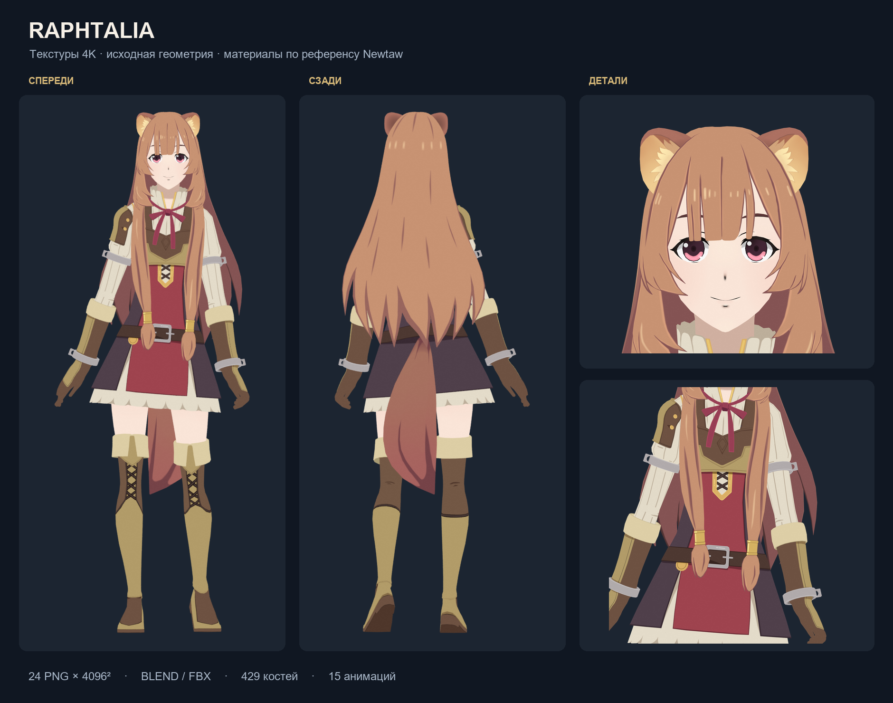

# Рафталия — текстуры и материалы, 5 ноября 2026

Текущая подготовленная модель полностью текстурирована по [референсу Newtaw](https://sketchfab.com/3d-models/raphtalia-the-rising-of-the-shield-hero-4b283bf024c3405ea6b8a9c68d0e1c5b). Восстановлены 24 цветовые PNG-карты 4096 × 4096; настроены все 26 материалов. Геометрия, UV, нормали, веса, риг и анимационные ключи сохранены. Изображения восстановлены из публичного просмотрщика референса, а не нарисованы заново приблизительно. Авторство исходного художественного оформления — Newtaw.

## Готовые файлы

| Файл | Назначение |
|---|---|
| [Raphtalia_prepared.blend](../../../assets/models/Raphtalia_prepared.blend) | Редактируемая модель, риг, 15 Actions и 24 упакованных изображения; открывается автономно |
| [Raphtalia_prepared.fbx](../../../assets/models/Raphtalia_prepared.fbx) | Текущий FBX с сохранёнными запечёнными анимациями и относительными ссылками на PNG |
| [Текстуры](../../../assets/textures/raphtalia/) | Полный комплект отдельных цветовых карт |
| [Архив для переноса](../../../deliverables/raphtalia/Raphtalia_textured_4K.zip) | BLEND, FBX, изображения, превью, инструкция и SHA256; сохраняет структуру models/textures |
| [Резервная копия до текстурирования](../../../assets/models/backups/Raphtalia_prepared.pre_texturing_2026-11-05.zip) | Точные прежние BLEND/FBX и их контрольные суммы |

Основной `julia_desktop` также получил обновлённые файлы модели и текстуры. Его исходный код и настройки анимационного поведения не менялись.

## Анализ исходного состояния

За основу взят актуальный `Raphtalia_prepared.blend`, а не другая модель `Raphtalia1.fbx`. В Blender он содержит **28 мешей, 42 041 вершину, 68 944 полигона, 429 костей и 15 Actions**. Это количества подготовленного исходника до текущей работы; дополнительные вершины век появились на предыдущих этапах. Вершины, пропорции и детализация персонажа на этапе текстурирования не изменялись.

В исходном BLEND не было изображений. Все 26 материалов существовали, но не содержали Image Texture nodes; FBX имел ноль Texture/Video records. Подключённые пустые Normal Map nodes не давали достоверной поверхности. Файлы `body_color.png`, `hair_color.png` и `shield_color.png` принадлежат другому локальному ассету с тремя материалами и другой UV-развёрткой; они не использовались и сохранены.

У 27 мешей есть слой `UVMap`; все его координаты находятся в диапазоне 0–1. Оставшийся меш `hightlight_hightlight_0` — геометрические блики глаз без UV, для него нужен постоянный светлый цвет. `tex_skin2` использует ту же карту кожи, что и `tex_skin`. Манжеты и части одежды также намеренно используют общие карты. Поэтому итог — 24 изображения, 25 назначений текстуры материалам и 27 текстурированных мешей из 28. Отсутствие карты у геометрических бликов корректно.

Исходные схемы развёрток сохранены как `tex_*_uv.png`; точные хэши координат, индексов, UV и весов находятся в [before.json](before.json).

## Соответствие референсу

У референса совпадают все 26 названий материалов. Настройки публичного просмотрщика связывают их с 24 картами, включая совместное использование карты кожи. Назначения взяты из этих настроек и затем проверены на текущем меше; одного совпадения имён для решения не использовалось.

| Область | Восстановленные особенности |
|---|---|
| Волосы | Семь самостоятельных карт: тёплый каштановый основной цвет, бордово-коричневые тени, светлые рисованные блики и линии отдельных прядей |
| Кожа | Светлый персиковый тон, мягкие локальные оттенки, детали носа и рта; корректное размещение на лице, шее и ногах |
| Глаза | Тёмная винно-фиолетовая радужка, розовый нижний сегмент, зрачок и светлые блики; отдельные ресницы и склера |
| Уши и хвост | Две карты ушей с кремовым внутренним мехом; тёплая коричневая карта хвоста с рисованными тенями |
| Одежда | Кремовая рубашка с линиями складок, бордовая центральная часть платья, тёмные боковые панели, золотистая окантовка |
| Броня и аксессуары | Коричневая кожа, золотистая отделка, плечевой элемент и заклёпки, пояс и серебристая пряжка, наручи, манжеты, бант, шнуровка и обувь |

Примеры опорных цветов самих карт в sRGB: волосы `#C79272`, тени волос `#875555`, кожа `#F9E4D7`, кожа брони `#6D5141`, золотистая отделка `#B39D69`, ткань рубашки `#E3DBC9`, бант `#973E54`. Это цвета изображений; итоговые экранные значения зависят от освещения и цветового преобразования.

Карты просмотрщика хранятся в переставленном пиксельном представлении. Оно преобразовано в обычные PNG без интерполяции и потери исходных RGB-значений. Ориентация растра согласована с уже существующим направлением V локального FBX/BLEND. **Сами UV не отражались, не сдвигались и не перепаковывались.** После проверки исправлена именно ориентация изображений, чтобы нос, радужки, детали одежды и мех совпали с поверхностью.

Список изображений, исходные публичные URL, идентификаторы и контрольные суммы: [texture_sources.json](texture_sources.json). Настройки источника: [reference_options.json](reference_options.json). Сводная таблица изображений: [maps_contact.png](maps_contact.png). Описание пиксельного формата использовалось из [первичного технического источника](https://github.com/Corpocore/sfrip/blob/main/lib/descramble.js); внешняя программа не устанавливалась и не исполнялась.

## Настройка материалов

В референсе глобальный режим — `shadeless`, а normal, bump, AO и roughness-текстуры выключены. Тени, блики и большая часть мелких деталей уже нарисованы в цветовых картах. Для соответствия этой стилизации BLEND использует **Image Texture → Emission → Material Output**, sRGB, линейную фильтрацию, `UVMap`, scale 1 и offset 0. Неподключённый Principled BSDF оставлен как подготовленная возможность перехода к освещаемому материалу.

Изображения упакованы в BLEND, а их файловые пути дополнительно записаны относительно `../textures/raphtalia/`. Альфа не управляет вырезанием поверхностей: в референсе соответствующие каналы выключены. Небольшое отклонение альфы исходной карты кожи от 255 игнорируется материалом. Геометрия волос, ресниц и меха сохранена.

FBX содержит обычные Diffuse Color texture connections, белый множитель, ссылки на UV0 и относительные пути. Формат FBX не обеспечивает одинаковое unlit-отображение во всех программах: в целевом движке для точного вида референса следует использовать unlit/base-color shader. Текущий JULIA сохраняет свой прежний toon-свет; его светотеневые грани видны на [настоящем кадре desktop](runtime_neutral_view_0.png). Это отличие освещения от unlit-превью, а не смещение текстуры. Искусственные normal/roughness-карты не добавлялись, поскольку они изменили бы исходный стиль.

## Проверки сохранности и отображения

| Проверка | Результат |
|---|---|
| Координаты, топология, нормали и UV BLEND | Точное совпадение до/после |
| Веса, vertex groups, modifiers, constraints, drivers | Точное совпадение |
| Кости, родители, rest matrices, Actions и их ключи | 429 костей и 15 Actions сохранены точно |
| Вычисленная нейтральная поверхность | Точное совпадение вершин |
| Текстуры | 24 × 4096², sRGB, все упакованы, SHA256 совпадают с манифестом |
| FBX | 90 414 нематериальных объектов и 121 761 прежняя связь сохранены; запечённые анимации не переэкспортировались |
| Импорт Assimp 6.0.4 | 28 мешей, 26 материалов, 15 клипов, 25 texture slots, отсутствующих файлов — 0 |
| Основной desktop / OpenGL 3.3 NVIDIA | Загружены все 24 изображения, 27/28 мешей с картами; orbit/zoom/pan, 120 кадров — PASS |
| Взгляд и моргание в основном desktop | PASS, 65 framebuffer-изображений, OpenGL errors — 0 |
| Визуальная проверка | Спереди, сзади, три четверти, лицо, одежда; проверены нейтральные и закрытые глаза |

Отчёты: [BLEND](blend_preservation.json), [FBX](fbx_preservation.json), [Assimp](assimp.json), [desktop](runtime_summary.json), [моргание](runtime_blink_full_view_0.png). На проверенных ракурсах смещений рисунка и крупных разрывов по UV-швам не обнаружено. Исходная низкополигональная поверхность и ранее известные особенности деформации век не редактировались. Проверка не означает сертификацию всех возможных поз и освещения.

## Повторное использование

Откройте BLEND для готового вида, соответствующего unlit-референсу. Для FBX распакуйте архив целиком и сохраните соседние папки `models` и `textures`. В импортёре включите материалы/текстуры, а в целевом шейдере выберите sRGB base color; яркость и тени не следует запекать повторно поверх рисованных теней.

Точные исходные `Raphtalia.fbx`, его первоначальная резервная копия, `Raphtalia1.fbx`, три прежних изображения и ранние архивы сохранены. До обновления текущих prepared-файлов создан отдельный ZIP с их прежними SHA256. Актуальный `deliverable_manifest.json` обновляет только две prepared-записи; его прежнее состояние сохранено рядом с этим отчётом.
